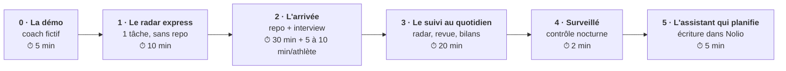

# Automatisation — du radar du matin à l'assistant qui planifie

> **À quoi sert ce fichier :** les 6 niveaux d'automatisation de l'assistant, et comment installer chacun, pas à pas. Tu peux t'arrêter à n'importe quel niveau : chacun est utile seul.
> **Mis à jour par :** contenu du projet.



| Niveau | Tu ajoutes | Tu obtiens |
|---|---|---|
| **0 · La démo** | rien | l'assistant qui tourne sur un coach fictif et ses 4 athlètes |
| **1 · Le radar express** | une tâche planifiée et le connecteur Nolio, **sans repo** | chaque matin : qui a une douleur, qui a sauté une séance, qui a une séance clé, qui court bientôt |
| **2 · L'arrivée** | ton repo, une conversation | ta philosophie, tes seuils, une fiche par athlète (découvert dans Nolio), avec ta méthode adaptée à chacun |
| **3 · Le suivi au quotidien** | 4 tâches planifiées | un radar qui connaît chaque athlète, une revue du soir avec des brouillons de commentaires, des bilans par athlète et pour le groupe |
| **4 · Surveillé** | la GitHub Action (déjà là) | un mail si une tâche ne tourne pas, et un assistant qui s'améliore avec tes retours |
| **5 · L'assistant qui planifie** | la permission de création dans Nolio | des semaines proposées dans ta philosophie, écrites dans Nolio quand tu dis « je valide » |

---

## Ce qu'il te faut

- Un compte **Claude** Pro ou Max : les tâches planifiées en ont besoin.
- Un **compte coach Nolio** (payant) : le connecteur se branche dessus et voit tes athlètes. Voir `docs/nolio.md`.
- Pour les niveaux 2 et plus : un compte **GitHub** (gratuit).
- **L'accord de tes athlètes** avant d'analyser leurs données : `docs/consentement-rgpd.md`.

## Niveau 0 — La démo (5 min)

1. Crée ton repo depuis le template (étape 1 du niveau 2).
2. Dans `reglages.md`, remplace `plateforme: nolio` par `plateforme: demo`.
3. Ouvre une session sur ton repo et dis « Fais le radar du matin ». L'assistant lit `examples/sample-coach/` et son faux Nolio, sans rien écrire.
4. Essaie aussi « Fais la revue du soir du 23 octobre », « Fais la fiche de Sophie », « Prépare un message pour Léo ».

Le scénario est décrit dans `examples/sample-coach/README.md`. Remets `plateforme: nolio` ensuite.

## Niveau 1 — Le radar express (10 min, sans repo)

1. **Branche Nolio** : Claude → **Réglages → Connecteurs** → Nolio (ou un connecteur personnalisé `https://mcp.nolio.io/mcp`). Connecte ton compte coach, en **lecture** seulement.
2. **Crée une tâche planifiée** : onglet **Code** → **Planifiées** (ou [claude.ai/code/routines](https://claude.ai/code/routines)) → **Nouvelle tâche**.
   - Nom : « Radar du matin ».
   - Prompt : copie tout ce qui suit la ligne `---` dans `automations/radar-express.md`.
   - Repo : **aucun**.
   - Connecteurs : Nolio seulement.
   - Fréquence : tous les jours, 07:07.
3. **Teste** : clique sur **Exécuter maintenant**, puis lis le radar dans l'onglet Code de l'app Claude.

Les seuils sont dans le texte du prompt : change-les avec tes mots. Sa limite, c'est qu'il ne connaît pas tes athlètes. C'est le rôle du niveau 2.

## Niveau 2 — L'arrivée (30 min, puis 5 à 10 min par athlète)

1. **Crée ton repo** : sur la page GitHub du projet, **Use this template** → **Create a new repository** → coche **Private** (obligatoire : il contiendra des données de santé de tes athlètes).
2. **Connecte GitHub à Claude** (une fois) : va sur [claude.ai/code](https://claude.ai/code), accepte de connecter GitHub. Quand GitHub demande à quels repos Claude a accès, choisis **All repositories**, ou **Only select repositories** en cochant ton repo.
   Ton repo n'apparaît pas ? GitHub → ta photo → **Settings** → **Applications** → **Installed GitHub Apps** → **Claude** → **Configure** → ajoute-le.
3. **Ouvre une session** sur ton repo (claude.ai/code ou l'onglet Code de l'app), avec le connecteur Nolio actif.
4. **Dis « Lance mon arrivée »** (`conversations/arrivee-coach.md`). L'assistant :
   - te pose quelques questions sur toi ;
   - lit tes plans dans Nolio et te propose ta philosophie, que tu corriges ;
   - règle tes seuils d'alerte ;
   - liste tes athlètes dans Nolio et te demande leur consentement (message type fourni) ;
   - fait la fiche de chaque athlète avec toi, en commençant par ceux qui ont une course proche.
5. Tu peux t'arrêter quand tu veux : « On reprend mon arrivée » repart du bon endroit.

## Niveau 3 — Le suivi au quotidien (20 min)

Crée 4 tâches planifiées (onglet **Code** → **Planifiées** → **Nouvelle tâche**). Pour chacune :
- **Prompt** : le talon ci-dessous, en changeant le nom du fichier.
- **Repo** : ton repo.
- **Connecteurs** : Nolio seulement.
- **Modèle** : celui du tableau.

| Nom | Fichier | Quand | Modèle |
|---|---|---|---|
| Assistant — radar du matin | `automations/radar-matin.md` | tous les jours, 07:07 | rapide (Sonnet) |
| Assistant — revue du soir | `automations/revue-soir.md` | tous les jours, 20:37 | rapide (Sonnet) |
| Assistant — bilan hebdo | `automations/bilan-hebdo.md` | le dimanche, 19:07 | capable (Opus) |
| Assistant — bilan mensuel | `automations/bilan-mensuel.md` | le 1er du mois, 08:07 | capable (Opus) |

Une fois le radar complet en place, supprime ou mets en pause le radar express du niveau 1.

**Le prompt talon** :

```text
Lis CLAUDE.md, puis exécute le prompt du fichier automations/radar-matin.md (tout ce qui suit la ligne ---).
Date du jour : aujourd'hui, dans le fuseau de reglages.md.
C'est une tâche planifiée : n'écris jamais dans Nolio et n'envoie rien à personne.
Termine par un commit et un push sur main.
```

Pourquoi un talon ? Toute la logique vit dans le repo : pour changer le radar, tu modifies `automations/radar-matin.md` (ou tu le demandes à l'assistant), sans revenir dans les réglages de Claude.

**Tester** : **Exécuter maintenant** sur chaque tâche, puis vérifie que le message arrive, qu'un fichier apparaît dans `reports/`, et qu'une ligne `ok` est ajoutée à `automations/runs.md`, sur `main`.

**Au quotidien** : chaque exécution est une session dans l'onglet Code de l'app Claude. Tu y réponds : « Fais la fiche de Paul », « Raccourcis le brouillon pour Julie », « Analyse la séance de Marc ».

Tu peux aussi tout lancer à la main dans une session, avec les commandes `/radar`, `/revue`, `/bilan-hebdo`, `/analyse-seance`, `/message`, `/nouvel-athlete`, `/bilan-progression`, `/planifier` et `/arrivee`.

## Niveau 4 — Surveillé (2 min)

- **Le contrôle nocturne** : chaque tâche ajoute une ligne à `automations/runs.md`. Chaque nuit, la GitHub Action « Contrôle de l'assistant » lance `scripts/controle.py`. Si une tâche n'a pas tourné, a échoué, ou si un lien du repo est cassé, GitHub t'envoie un mail. Dans l'onglet **Actions** de ton repo, active les workflows si GitHub le demande, puis lance **Run workflow** une première fois.
- **La boucle d'amélioration** : chaque tâche finit par une question. Tes réponses vont dans `coach/retours-agent.md`, et l'assistant ajuste ses prompts quand tu valides.

## Niveau 5 — L'assistant qui planifie (5 min)

1. **Permissions Nolio** : reconnecte le connecteur en cochant **lecture + création + suppression**. Jamais « modification » : Nolio ne sait pas l'annuler.
2. Dans `reglages.md` : `permissions_nolio: lecture+creation+suppression`.
3. Essaie : « Propose la semaine prochaine de <athlète> » (`conversations/planifier.md`), lis le récap, réponds « je valide », puis vérifie dans Nolio et dans `plan/registre-nolio.md`.

Le bilan du dimanche peut proposer des ajustements. Ils ne sont écrits qu'après ton « je valide » dans sa session. Une séance que tu as écrite toi-même n'est jamais touchée.

## Niveau expert — tes Google Sheets

Récap de courses, programmes de renforcement, suivis : synchronise-les dans `drive-sources/` chaque nuit (`drive-sources/README.md`). Le bilan de progression s'en sert.

---

## Coût et consommation : rester léger

Les tâches planifiées consomment ton abonnement Claude. Le nombre d'exécutions est fixe (environ 65 par mois), mais **la taille de chaque exécution grandit avec ton nombre d'athlètes**. Ce qui la garde raisonnable :
- **Trier d'abord, détailler ensuite** : le radar ne lit le dossier d'un athlète que s'il est en alerte ou a une séance clé.
- **Une mémoire courte** : `etat.md` et `athletes/index.md`, lus à la place des dossiers.
- **Des fenêtres Nolio explicites** : 24 h pour le radar, 7 jours pour l'hebdo.
- **Le bilan hebdo s'appuie sur les radars** de la semaine au lieu de tout relire.
- **Un seul connecteur coché** par tâche, et un modèle rapide au quotidien.

Après une semaine, regarde ta consommation dans Claude (**Réglages → Utilisation**). Avec beaucoup d'athlètes, garde le radar et le bilan hebdo, et lance la revue du soir à la main les jours chargés.

## Quand ça coince

| Symptôme | Cause probable | Que faire |
|---|---|---|
| Mon repo n'apparaît pas dans Claude | Claude n'a pas accès à ce repo sur GitHub | GitHub → Settings → Applications → Claude → Configure → ajoute le repo |
| « Je ne vois pas tes athlètes » | connecteur branché sur un compte athlète, ou décoché dans la tâche | reconnecte Nolio avec ton compte coach, et coche-le dans la tâche |
| Un athlète manque dans le radar | `statut` ou `consentement` dans `athletes/index.md` | vérifie qu'il est `actif` et `oui` |
| Trop d'alertes | seuils par défaut trop sensibles pour toi | dis-le à l'assistant, ou modifie `coach/criteres-alertes.md` (ou le profil de l'athlète) |
| Les rapports n'arrivent pas sur `main` | push sur une branche `claude/…` | vérifie que le talon dit bien « push sur main » |
| Mail « Contrôle de l'assistant » en échec | tâche absente, en échec, ou lien cassé | le mail contient le rapport |
| L'assistant refuse d'écrire dans Nolio | niveau 5 pas activé, ou tâche planifiée | c'est voulu : voir le niveau 5 |
