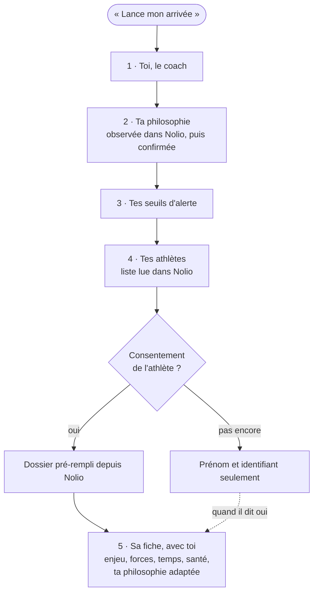
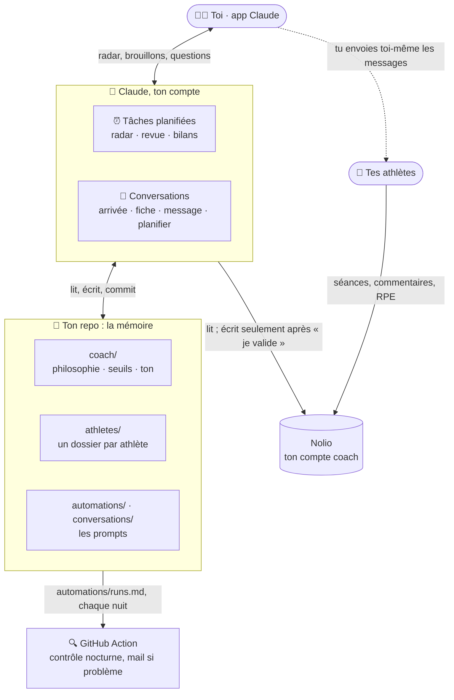
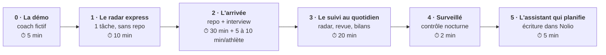

# 🧑‍🏫 Assistant de coaching · Claude × Nolio

> **À quoi sert ce fichier :** présenter le projet, montrer ce qu'il fait, et emmener un coach de zéro à son premier radar du matin.
> **Mis à jour par :** contenu du projet.

**Un assistant pour coachs d'endurance (course à pied, trail…), propulsé par Claude et branché sur Nolio.**
Chaque matin, il te dit quels athlètes ont besoin de toi. Le soir, il analyse leurs séances et prépare tes commentaires. Le dimanche, il fait le bilan de chaque athlète et du groupe. Et il connaît chacun d'eux comme toi, parce qu'il a commencé par t'interviewer.

**Zéro code, zéro installation** : un dossier de fichiers texte sur GitHub (la mémoire), Claude (le cerveau) et des tâches planifiées (le rythme). Et le niveau 1 marche même sans GitHub : un seul texte à coller.

    

> 🤝 **Le coach décide.** L'assistant lit, signale, prépare et propose. Il n'écrit jamais à tes athlètes, ne pose pas de diagnostic, et ne touche à un plan qu'après ton « je valide ».

Tu es coureur et tu veux un coach pour toi ? C'est le projet jumeau : [`running-coach-athletes`](https://github.com/VitoPepe/running-coach-athletes).

---

## Sommaire

- [Ce que fait ton assistant](#-ce-que-fait-ton-assistant)
- [L'arrivée : il apprend à te connaître](#-larrivée--il-apprend-à-te-connaître)
- [Comment ça marche](#-comment-ça-marche)
- [Les 6 niveaux d'automatisation](#-les-6-niveaux-dautomatisation)
- [Démarrer](#-démarrer)
- [Les automatisations et les conversations](#-les-automatisations-et-les-conversations)
- [Ce qu'il y a dans le repo](#-ce-quil-y-a-dans-le-repo)
- [Garde-fous](#-garde-fous) · [Tes athlètes et leurs données](#-tes-athlètes-et-leurs-données) · [Coût](#-coût-et-consommation) · [Limites](#-limites)
- [FAQ](#-faq) · [Documentation](#-documentation) · [Contribuer](#-contribuer)

---

## ✨ Ce que fait ton assistant

| Quand | Quoi |
|---|---|
| 📡 **Chaque matin** | le radar : 🔴 à traiter aujourd'hui (douleur, séance arrêtée, RPE qui explose), 🟠 à surveiller, ⭐ séances clés à vérifier, 🏁 courses à venir, 🆕 nouvel athlète dans Nolio. Lisible en 2 minutes. |
| 🌙 **Chaque soir** | les séances du jour : une ligne pour les conformes, une analyse pour les séances clés et les écarts, et un commentaire prêt à coller dans Nolio, dans ton ton. |
| 📊 **Chaque dimanche** | un bilan par athlète, une synthèse du groupe (qui progresse, qui décroche), et la semaine planifiée vérifiée contre la fatigue observée et ta philosophie. |
| 🗓️ **Chaque 1er du mois** | la progression de chaque athlète vers ses objectifs, les tests à planifier, les objectifs à revoir. |
| 🏁 **Autour d'une course** | l'affûtage vérifié contre ta règle, les points de préparation de J-7 à J-1, le message de veille, puis le débrief du lendemain. |
| 💬 **Quand tu veux** | « Analyse la séance de Marc », « Prépare un message pour Léo », « Propose la semaine de Julie », « Fais le bilan de progression de Sophie ». |

### Un radar du matin

> **📡 Radar du samedi 24 octobre**
>
> 👥 4 athlètes suivis · 3 séances hier · 3 alertes
>
> 🔴 À traiter aujourd'hui
> - Léo — course continue 30 min, vendredi 23 — « petite gêne tibia gauche 3/10 en fin de séance » : le tibia de sa périostite, à sa première séance à 30 min → appelle-le ce matin : où exactement ? combien sur 10 au réveil ? mal en appuyant sur l'os, la nuit ou au repos ? Protocole : retour en phase 1 (marche-course) 3 à 5 jours ; dimanche, marche-course ou vélo à la place des 30 min. Un oui à la 3e question : kiné avant toute reprise (injuries/periostite.md, sante.md de Léo)
>
> 🟠 À surveiller
> - Julie — footing 50 min, vendredi 23 — 20 min sur 50 au-dessus de 150 (FC moy 151), avec une copine du club, RPE 3 : 3e fois en 3 semaines ; VFC en baisse, encore dans sa marge → envoie le brouillon d'hier soir ; plafond 150 pour son footing d'aujourd'hui et sa sortie longue de demain ; 3 fois en un mois : on en parle de vive voix (philosophie de Julie)
> - Sophie — footing de jeudi non fait, puis 32 min courues vendredi hors plan, sans commentaire → un mot pour savoir ce qui s'est passé ; sa sortie longue de 55 min aujourd'hui fait 2 jours de course de suite (profil) : la garder très facile, ou la passer à dimanche
>
> ⭐ Séances clés à vérifier
> - Marc — aujourd'hui : sortie longue 2 h 30, 1 000 m de D-, 3 × 10 min de descente technique — repos hier, VFC 75 et FC repos 44 dans sa norme, descentes « plus fluides » mercredi : contexte favorable. Ce soir, demande-lui ses quadriceps : raides plus de 48 h = on allège la descente de l'affûtage (philosophie de Marc)
>
> 🏁 Préparation de course
> - Marc — Ultra des Aiguilles (fictif), 75 km — J-14 — dernière séance clé ; l'affûtage de 2 semaines démarre demain (sa philosophie) : début conforme (récup facultative dimanche, repos lundi, 1 h avec 5 × 1 min en côte mardi). Je vérifie la baisse de volume au bilan de demain ; à caler avec lui : stratégie, ravito, matériel obligatoire
>
> 🆕 Nouvel athlète : Paul Lefèvre est arrivé dans Nolio hier → on fait sa fiche ? Il faut d'abord son accord (message type dans [docs/consentement-rgpd.md](docs/consentement-rgpd.md)). Je n'ai lu aucune de ses séances.
>
> 🔧 Pour m'améliorer : pour Léo, je propose directement le retour en phase 1 du protocole. Tu préfères ça, ou que je m'en tienne à l'appel ?

*Exemple écrit à partir des données de démo de [Hugo, le coach fictif](examples/coach-fictif/README.md). Toutes les données sont inventées.*

---

## 🎙️ L'arrivée : il apprend à te connaître

Pas de formulaire à remplir. Tu dis « Lance mon arrivée », et l'assistant :
1. **découvre tes athlètes dans Nolio**, et crée un dossier pour chacun, pré-rempli avec son volume, ses records et ses compétitions ;
2. **lit tes plans et te propose ta philosophie** (« tu fais du polarisé, 2 séances dures max, une semaine allégée toutes les 4 ? »), que tu corriges ;
3. **règle tes seuils d'alerte** en 5 questions ;
4. **demande le consentement** de chaque athlète, avec un message type à lui envoyer ;
5. **t'interviewe sur chaque athlète**, une question à la fois : son enjeu, ses forces, ses temps, ses blessures, et **ce que tu fais différemment avec lui**.

Tu peux t'arrêter quand tu veux : il reprend là où vous en étiez. Un athlète qui arrive plus tard dans Nolio est repéré par le radar, qui propose sa fiche.



Un extrait d'arrivée : [examples/coach-fictif/sorties/arrivee-extrait.md](examples/coach-fictif/sorties/arrivee-extrait.md).

---

## 🧠 Comment ça marche



**Trier d'abord, détailler ensuite.** Le radar fait un passage léger sur tous tes athlètes. Il n'ouvre le dossier complet (profil, philosophie, santé) que pour ceux qui sont en alerte ou qui ont une séance clé. C'est ce qui lui permet de suivre 5 ou 30 athlètes.

**Ta philosophie à deux étages.** Ta méthode générale vit dans `coach/philosophie/`. Ce que tu fais différemment pour un athlète vit dans son `philosophie.md`, et c'est elle qui s'applique en premier.

Tous les schémas : [docs/architecture.md](docs/architecture.md).

---

## 🪜 Les 6 niveaux d'automatisation



| Niveau | Tu ajoutes | Tu obtiens |
|---|---|---|
| **0 · La démo** | rien | l'assistant sur un coach fictif et ses 4 athlètes |
| **1 · Le radar express** | une tâche planifiée et Nolio, **sans repo** | chaque matin, qui a besoin de toi |
| **2 · L'arrivée** | ton repo, une conversation | ta philosophie, tes seuils, une fiche par athlète |
| **3 · Le suivi au quotidien** | 4 tâches planifiées | radar complet, revue du soir et brouillons, bilans par athlète et du groupe |
| **4 · Surveillé** | la GitHub Action (déjà là) | un mail si une tâche ne tourne pas, un assistant qui s'améliore |
| **5 · L'assistant qui planifie** | la création dans Nolio | des semaines proposées dans ta philosophie, écrites après ton « je valide » |

Le pas-à-pas de chaque niveau : **[AUTOMATISATION.md](AUTOMATISATION.md)**.

---

## 🚀 Démarrer

**Il te faut** un abonnement Claude Pro ou Max, un compte coach Nolio (payant), et à partir du niveau 2 un compte GitHub (gratuit).

**En 10 minutes (niveau 1)** : branche Nolio dans Claude (Réglages → Connecteurs), crée une tâche planifiée à 07:07 sans repo, et colle le prompt de [automations/radar-express.md](automations/radar-express.md). Demain matin, tu as ton radar.

**L'assistant complet (niveaux 2 et 3)** :
1. **Crée ton repo** : **Use this template** → **Create a new repository** → coche **Private**.
2. **Connecte GitHub à Claude** sur [claude.ai/code](https://claude.ai/code), et donne-lui accès à ton repo.
3. **Ouvre une session** sur ton repo, avec Nolio actif, et dis **« Lance mon arrivée »**.
4. **Crée les 4 tâches planifiées** avec le prompt talon : [AUTOMATISATION.md › Niveau 3](AUTOMATISATION.md#niveau-3--le-suivi-au-quotidien-20-min).
5. **Active le contrôle nocturne** : onglet Actions de ton repo.

Tu veux d'abord voir ? Mets `plateforme: demo` dans `reglages.md`, puis dis « Fais le radar du matin ».

---

## ⚙️ Les automatisations et les conversations

### Ce qui tourne tout seul (`automations/`)

| Tâche | Quand | Rôle | Écrit |
|---|---|---|---|
| [Radar express](automations/radar-express.md) | tous les jours, 07:07 | niveau 1 : le tri du matin, sans repo | rien |
| [Radar du matin](automations/radar-matin.md) | tous les jours, 07:07 | le tri, avec la connaissance de chaque athlète | `bilans/quotidien/`, `etat.md` |
| [Revue du soir](automations/revue-soir.md) | tous les jours, 20:37 | analyses des séances clés, brouillons de commentaires | journaux des athlètes, `etat.md` |
| [Bilan hebdo](automations/bilan-hebdo.md) | dimanche, 19:07 | bilan par athlète, synthèse du groupe, semaine suivante vérifiée | `bilans/hebdo/` |
| [Bilan mensuel](automations/bilan-mensuel.md) | le 1er, 08:07 | progression, tests à planifier, ménage de la mémoire | `bilans/mensuel/` |

Modules lus seulement quand ils servent : [séance clé](automations/modules/seance-cle.md), [préparation de course](automations/modules/prepa-course.md), [blessure](automations/modules/blessure.md), [reprise](automations/modules/reprise.md), [nouvel athlète](automations/modules/nouvel-athlete.md).

### Ce que tu lances en parlant (`conversations/`)

| Conversation | Dis… | Commande |
|---|---|---|
| [Arrivée](conversations/arrivee-coach.md) | « Lance mon arrivée » | `/arrivee` |
| [Fiche athlète](conversations/fiche-athlete.md) | « Fais la fiche de Julie » | `/nouvel-athlete` |
| [Analyse de séance](conversations/analyse-seance.md) | « Analyse la sortie longue de Marc » | `/analyse-seance` |
| [Message à un athlète](conversations/message-athlete.md) | « Prépare un message pour Léo » | `/message` |
| [Planifier](conversations/planifier.md) | « Propose la semaine de Julie » | `/planifier` |
| [Bilan de progression](conversations/bilan-progression.md) | « Est-ce que Sophie progresse ? » | `/bilan-progression` |

---

## 📁 Ce qu'il y a dans le repo

```
├── CLAUDE.md              le cerveau : rôle, règles, garde-fous (lu à chaque session)
├── reglages.md            ton compte, tes permissions Nolio, l'avancement de l'arrivée
├── etat.md                la mémoire courte du groupe : alertes, séances clés, courses
├── AUTOMATISATION.md      les 6 niveaux, pas à pas
├── coach/                 toi : profil, philosophie, seuils d'alerte, ton, retours sur l'assistant
├── athletes/              index.md (tableau de bord) + un dossier par athlète, créé depuis Nolio
├── injuries/              tes protocoles par pathologie
├── strength/              tes séances de renforcement
├── assessments/           tes tests et indicateurs de progression
├── bibliotheque/          5 approches d'entraînement sourcées (référence, pas ta philosophie)
├── plan/                  le registre des écritures dans Nolio (niveau 5)
├── bilans/                quotidien, hebdo, mensuel, progression
├── automations/           les tâches planifiées, leurs modules, le journal technique
├── conversations/         arrivée, fiche, analyse, message, planifier, progression
├── drive-sources/         tes Google Sheets synchronisés (niveau expert)
├── docs/                  Nolio, consentement, personnaliser, architecture, tests, articles…
├── examples/coach-fictif/ Hugo et ses athlètes (et le mode démo)
└── scripts/ + .github/    contrôle nocturne, synchro Drive
```

---

## 🛡️ Garde-fous

- **Le coach décide.** L'assistant propose ; chaque recommandation cite sa source (ta philosophie, un protocole, une séance Nolio).
- **Jamais de message envoyé à un athlète.** Des brouillons dans ton ton, que tu envoies toi-même.
- **Pas de diagnostic.** Face à une douleur, tes protocoles de `injuries/`, et l'orientation vers un professionnel de santé quand il le faut. Les drapeaux rouges (douleur dans la poitrine, malaise, douleur qui fait boiter…) passent en tête du radar, avec un message fixe.
- **Tes plans protégés** par trois verrous :
  - les permissions Nolio (lecture seule jusqu'au niveau 4, jamais « modification ») ;
  - la règle « une tâche planifiée ne vaut pas accord » ;
  - le registre : l'assistant ne touche qu'aux séances qu'il a créées.
- **Alimentation bienveillante** : jamais de conseil de perte de poids ni de restriction dans un brouillon.

## 🔒 Tes athlètes et leurs données

- **Pas de consentement, pas d'analyse.** Sans accord de l'athlète, l'assistant ne lit pas ses données. Un message type est fourni : [docs/consentement-rgpd.md](docs/consentement-rgpd.md).
- **Repo privé, toujours** : il contient des données de santé.
- **Le moins de données possible**, et aucun secret dans le repo.
- **Un athlète qui s'en va** : son dossier est effacé sur ta demande.

Ce n'est pas un conseil juridique : pour un usage professionnel, fais valider ta démarche.

## 💸 Coût et consommation

- **Abonnements** : Claude Pro ou Max, un compte coach Nolio. GitHub est gratuit.
- **Usage** : environ 65 exécutions par mois. Leur taille grandit avec ton nombre d'athlètes, d'où le tri léger, la mémoire courte et les fenêtres Nolio courtes.
- Détails : [AUTOMATISATION.md › Coût](AUTOMATISATION.md#coût-et-consommation--rester-léger).

## 🚧 Limites

- Ce n'est **ni un coach, ni un médecin**. Il ne voit pas tes athlètes courir et se trompe parfois.
- Il dépend de **la qualité des données** : un commentaire vide, une FC poignet fausse, un RPE jamais saisi limitent ce qu'il voit.
- **Le niveau 1 ne connaît pas tes athlètes** : il donnera des fausses alertes, et en ratera.
- **Une tâche planifiée tourne au plus une fois par heure**, et n'écrit jamais dans Nolio d'elle-même.
- Les **noms d'outils du connecteur Nolio** peuvent évoluer : les prompts décrivent le besoin plutôt que l'outil.
- Première version **en français**.

---

## ❓ FAQ

**Mes athlètes doivent-ils installer quelque chose ?**
Non. Ils continuent d'utiliser Nolio comme avant. Il faut seulement leur accord pour que l'assistant analyse leurs données.

**L'assistant peut-il répondre directement à mes athlètes ?**
Non, c'est volontaire. Il prépare des brouillons dans ton ton, et tu les envoies.

**J'ai 30 athlètes, l'arrivée va durer des heures ?**
Les blocs 1 à 4 prennent environ 30 minutes, et tous les dossiers sont créés et pré-remplis depuis Nolio. Les fiches se font ensuite par petits morceaux, en commençant par les athlètes qui ont une course proche. Le radar marche dès le premier jour, même avec des fiches incomplètes.

**Ma philosophie n'est pas « écrite ». Ça marche quand même ?**
Oui, c'est le but de l'arrivée : l'assistant lit tes plans, te propose ce qu'il observe, et tu corriges. Tu ne pars jamais d'une page blanche.

**Et si je travaille différemment avec chaque athlète ?**
C'est prévu : `athletes/<slug>/philosophie.md` contient tes adaptations pour cet athlète, et elles passent avant ta philosophie générale.

**Je coache en team. Ça marche ?**
Oui, sur ton propre compte coach. La team peut limiter ce que ses coachs ont le droit de faire avec le connecteur Nolio : vérifie ses options.

**Est-ce légal de faire analyser les données de mes athlètes par une IA ?**
Avec leur consentement explicite, une information claire et le minimum de données, tu fais déjà l'essentiel. Mais ce n'est pas un conseil juridique : voir [docs/consentement-rgpd.md](docs/consentement-rgpd.md).

**Je n'utilise pas Nolio.**
La structure est prévue pour d'autres plateformes : tout ce qui est propre à Nolio est isolé dans [docs/nolio.md](docs/nolio.md) et dans une section de chaque automatisation.

---

## 📚 Documentation

| Guide | Pour… |
|---|---|
| [AUTOMATISATION.md](AUTOMATISATION.md) | installer chaque niveau, pas à pas |
| [docs/nolio.md](docs/nolio.md) | brancher ton compte coach et choisir les permissions |
| [docs/consentement-rgpd.md](docs/consentement-rgpd.md) | l'accord de tes athlètes, avec un message type |
| [docs/personnaliser.md](docs/personnaliser.md) | adapter l'assistant à ta façon de coacher |
| [docs/bonnes-pratiques.md](docs/bonnes-pratiques.md) | ce qui marche, et les pièges |
| [docs/architecture.md](docs/architecture.md) | tous les schémas |
| [docs/checklist-de-test.md](docs/checklist-de-test.md) | vérifier que tout marche |
| [docs/glossaire.md](docs/glossaire.md) | zones, VFC, RPE, charge, affûtage… |
| [bibliotheque/](bibliotheque/) | 5 approches d'entraînement, avec leurs sources |
| [drive-sources/README.md](drive-sources/README.md) | synchroniser tes Google Sheets (niveau expert) |
| [docs/journal-de-construction.md](docs/journal-de-construction.md) | les choix et les leçons de la construction |

---

## 🤝 Contribuer

Les contributions sont bienvenues, surtout :
- **une autre plateforme** que Nolio ;
- **des protocoles** pour `injuries/` validés par des professionnels de santé, et des séances pour `strength/` ;
- **une version anglaise** ;
- **des retours de coachs** : ouvre une issue (sans données d'athlètes).

Avant une pull request :
- garde le ton et l'en-tête de deux lignes de chaque fichier ;
- aucune donnée réelle ;
- passe la [checklist de test](docs/checklist-de-test.md) en mode démo ;
- lance `python3 scripts/controle.py`, sans lien cassé ;
- note tes choix dans [docs/journal-de-construction.md](docs/journal-de-construction.md).

---

## 📄 Licence et crédits

- Code, prompts et documentation : **[licence MIT](LICENSE)**.
- Projet indépendant, **non affilié à Nolio ni à Anthropic**. Nolio et Claude sont des marques de leurs propriétaires respectifs.
- Le coach des exemples, ses athlètes et leurs données sont **fictifs**.
