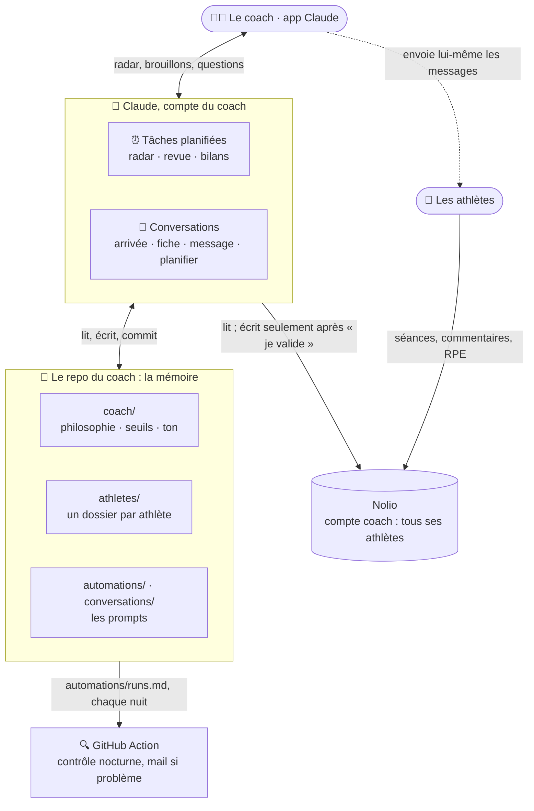
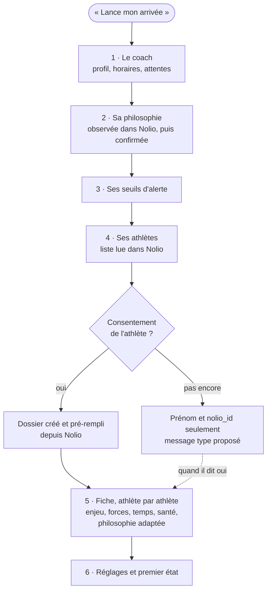
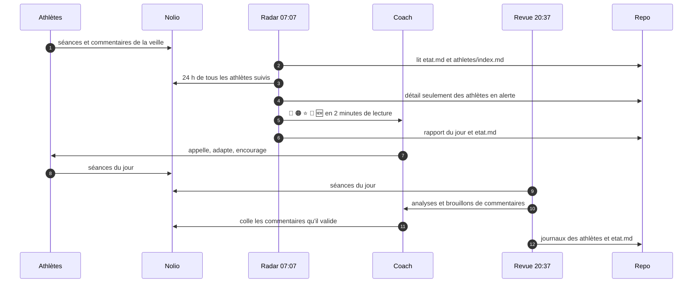
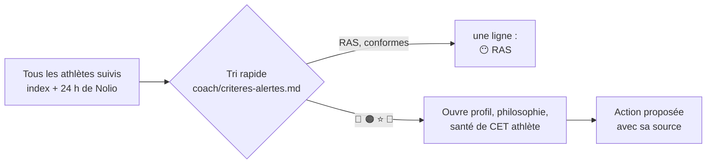
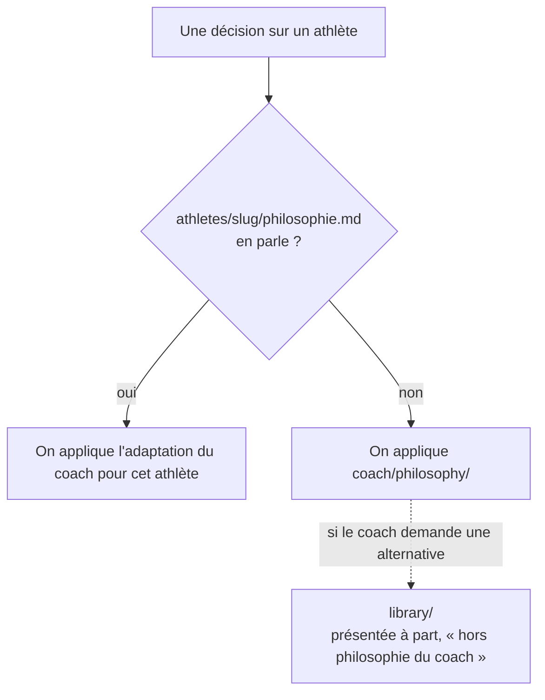
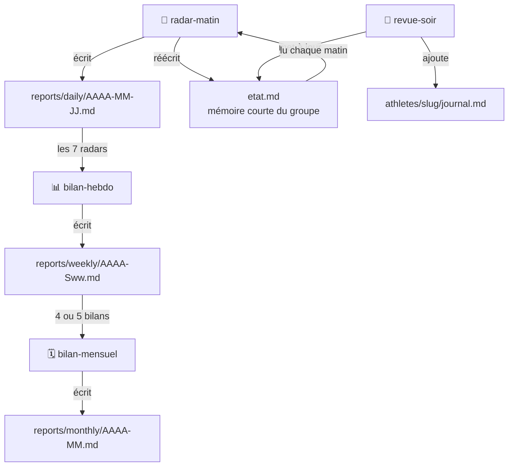
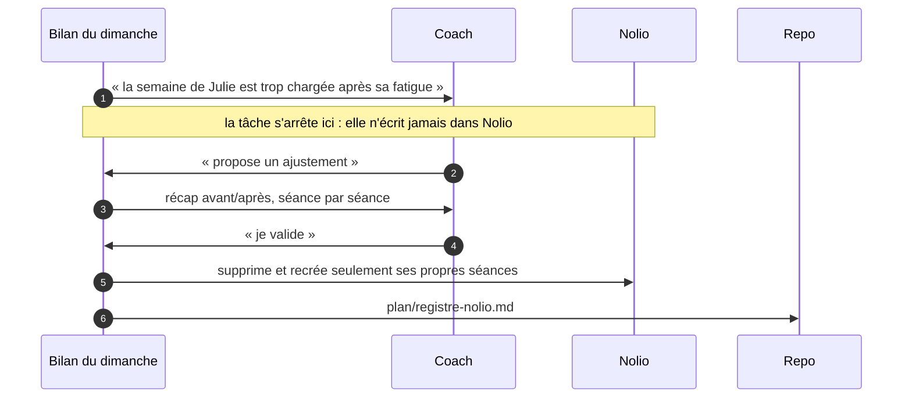
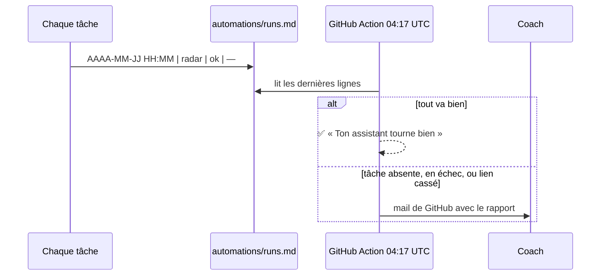

# Architecture — comment l'assistant fonctionne, en schémas

> **À quoi sert ce fichier :** comprendre le système d'un coup d'œil : qui parle à qui, comment l'arrivée remplit le repo, ce qui se passe dans une journée, comment le tri garde l'assistant économe, et comment les plans restent ceux du coach.
> **Mis à jour par :** contenu du projet.

## 1. Vue d'ensemble

L'assistant n'écrit **jamais** aux athlètes : il prépare des brouillons, et le coach les envoie.

## 2. L'arrivée : du compte Nolio au repo rempli

Chaque bloc est écrit et commité dès qu'il est fini : le coach peut s'arrêter et reprendre plus tard. Un athlète qui arrive ensuite dans Nolio est repéré par le radar, qui propose sa fiche.

## 3. Une journée

## 4. Trier d'abord, détailler ensuite

C'est ce qui permet de suivre 5 ou 30 athlètes sans que le coût explose.

## 5. Quelle philosophie s'applique

## 6. La mémoire : qui lit quoi

## 7. Le plan reste celui du coach (niveau 5)

Trois verrous :
1. **Les permissions Nolio** : la lecture seule jusqu'au niveau 4, et jamais « modification ».
2. **La règle de `CLAUDE.md`** : jamais d'écriture pendant une tâche planifiée, et jamais sans récap ni « je valide ».
3. **Le registre** : l'assistant ne touche qu'aux séances qu'il a créées lui-même.

## 8. Le contrôle nocturne

